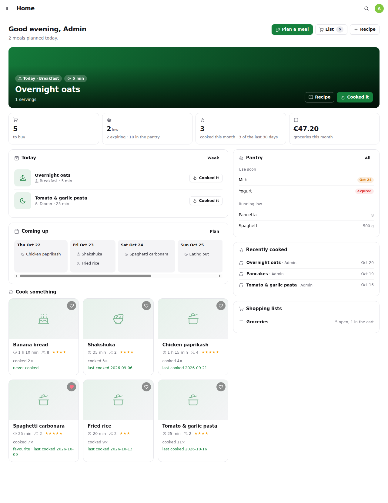
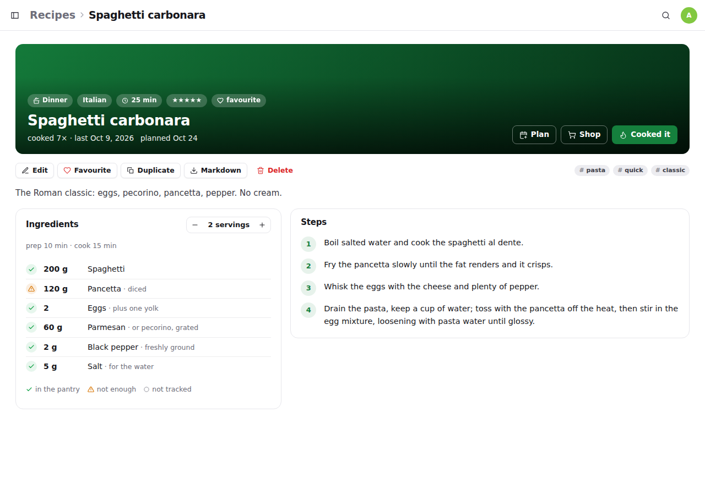
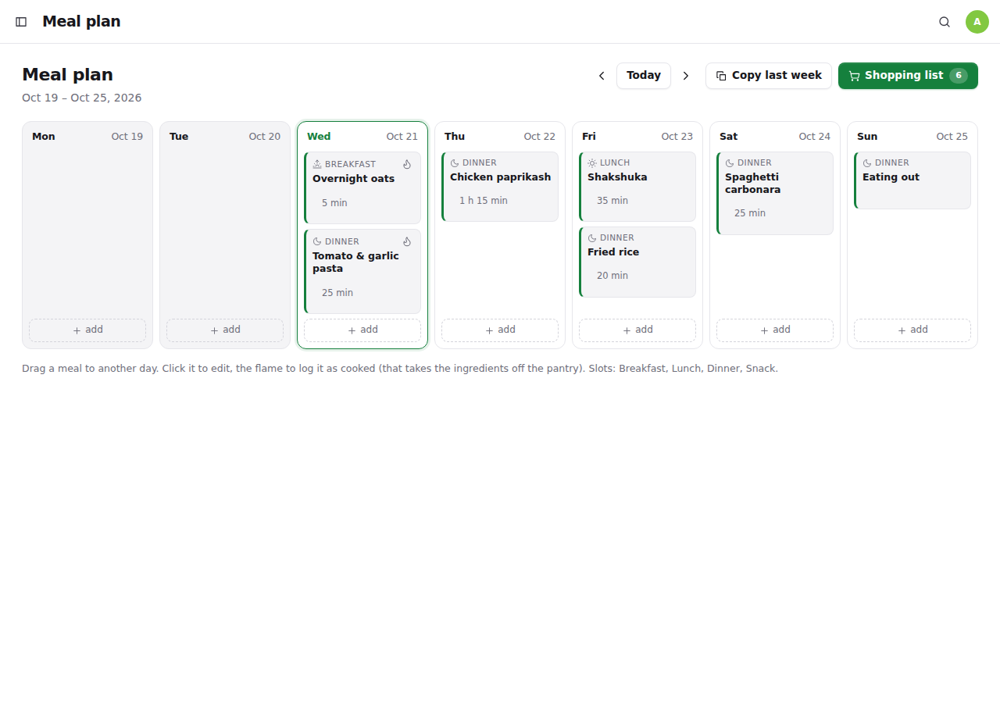
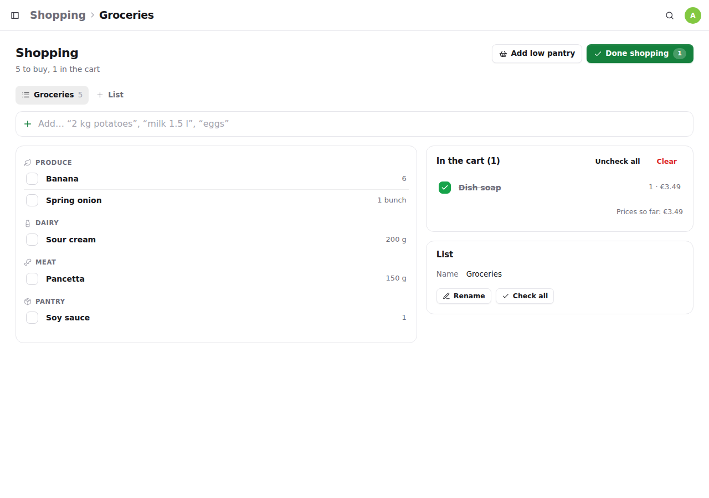
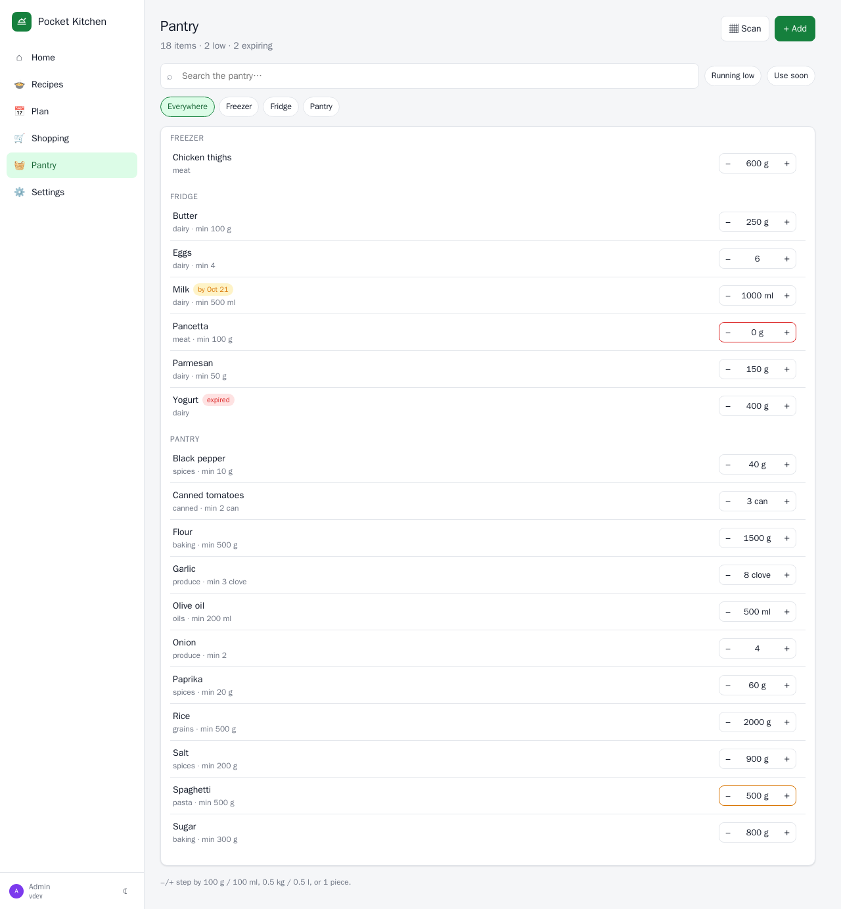

<p align="center">
  
</p>
<h1 align="center">Pocket Kitchen</h1>
<p align="center">
  Recipes, the week's meal plan, the shopping list and the pantry in one small self-hosted server — where the pantry is <b>Pocket Inventory</b>, the receipt goes to <b>Pocket Split</b>, and every cooked dish marks a <b>Pocket Habits</b> habit.<br>
  <b>One binary · one SQLite file · one volume.</b>
</p>
<p align="center">
  <a href="https://github.com/abjelosevic88/pocket-homelab-kitchen/actions"></a>
  <a href="https://github.com/abjelosevic88/pocket-homelab-kitchen/pkgs/container/pocket-homelab-kitchen"></a>
  <a href="LICENSE"></a>
</p>

---

Nothing on my server did recipes, a meal plan or a shopping list, and every app that does wants to own its own pantry, its own people and its own money. Pocket Kitchen does the cooking part and plugs into the apps that already own the rest:

- **Recipes that come from anywhere.** Paste a link — nearly every recipe site publishes schema.org data, so the title, times, servings, photo, ingredients and steps land in the editor ready to fix. Or type one in. Scale the servings on the page; tick off steps while you cook.
- **A pantry that is Pocket Inventory.** Items carrying one tag (`pantry`) *are* the pantry: synced in, quantities changed through Inventory's adjust endpoint so its movement log stays honest, new groceries created with the tag. Each recipe shows ✓ / ! / ○ per ingredient — enough, short, or not tracked. Without Inventory the pantry simply lives here.
- **A plan that writes the shopping list.** A week of slots, drag meals between days, copy last week. “Shopping list from the plan” scales every uncooked recipe, merges `200 g flour` with `0.5 kg flour`, and skips (or reduces) what the shelf already holds.
- **Shopping that ends in a checkout.** Lines grouped by aisle, quick-add understands “2 kg potatoes” and “milk 1.5 l”. “Done shopping” puts the bought items into the pantry, records the spend, and posts the receipt to **Pocket Split** as an expense split with the household.
- **“Cooked it” closes the loop.** Logs the dish, takes the ingredients off the shelf, bumps the recipe's count and marks a **Pocket Habits** habit (“cooked at home”) for the day.
- **Barcodes.** Scan with the phone camera: the pantry answers first, then Pocket Inventory, then **Open Food Facts** — name, brand, size, photo — and one tap adds it.
- **A daily push.** Today's meals and the pantry items to use soon, through Apprise, ntfy or a webhook. A `/dashboard` endpoint for a Homepage widget.

<p align="center"></p>

<table>
  <tr>
    <td width="50%"></td>
    <td width="50%"></td>
  </tr>
  <tr>
    <td align="center"><sub>Recipe: scale the servings, see what the pantry covers, cook it.</sub></td>
    <td align="center"><sub>Plan: drag meals between days, build the shopping list from the week.</sub></td>
  </tr>
  <tr>
    <td width="50%"></td>
    <td width="50%"></td>
  </tr>
  <tr>
    <td align="center"><sub>Shopping: aisles, quick-add, checkout to the pantry and Pocket Split.</sub></td>
    <td align="center"><sub>Pantry: every Pocket Inventory item with the pantry tag, −/+ in place.</sub></td>
  </tr>
</table>

## Features

| Area | What you get |
|---|---|
| **Recipes** | Title, description, servings, prep/cook time, course, cuisine, tags, rating, favourite, photo (upload or URL), ingredients with quantity/unit/note/optional/group, numbered steps, nutrition, notes, source. Import from a URL (JSON-LD, with a heuristic fallback). Search across ingredients, filter by course/tag/favourites, sort by recently cooked / most cooked / rating / time. Duplicate, Markdown export, cook history. |
| **Plan** | Breakfast, lunch, dinner, snack per day; a recipe or free text (“eating out”); servings per entry; drag & drop between days; copy a week forward; “Cooked it” straight from the card. |
| **Shopping** | Several lists; quick-add parsing (“2 kg potatoes”, “eggs x12”); lines merged by name and unit family; aisle guessed from the name; optional line prices; add every low pantry item in one go; checkout with total, store, restock, Pocket Split expense; purchase history. |
| **Pantry** | Mirrors Pocket Inventory items with the pantry tag (every 30 min + on demand) or stands alone; quantity, unit, minimum (low), location, category, barcode, brand, best-before (expiring), notes; −/+ steppers; ingredient-name matching with plurals and descriptors (“large eggs” → Eggs). |
| **Cooking** | Cook log with servings, notes and rating; pantry deduction with unit conversion (g/kg, ml/l/tsp/tbsp/cup); Pocket Habits mark; stats (cooked this month, days cooked out of 30). |
| **Integrations** | Pocket Inventory, Pocket Split, Pocket Habits, Open Food Facts, Apprise / ntfy / webhook, Homepage dashboard endpoint, Prometheus `/metrics`. With **Pocket Core** on the box: registers itself, publishes `kitchen.cooked` and `kitchen.checkout`, accepts paired-phone tokens, finds its siblings without `*_URL` settings, and offers “Sign in with Pocket Core” on the login page with no configuration (any other OpenID Connect provider via `OIDC_*`). |
| **Users & ops** | Built-in login (admin/member), SSO-proxy header, or no login on a trusted LAN. API tokens. SQLite backup from the UI/CLI/API, JSON export / merge-import. PWA with shortcuts for the list, the plan and the scanner. |

## Run it

```bash
mkdir pocket-kitchen && cd pocket-kitchen
curl -fsSLO https://raw.githubusercontent.com/abjelosevic88/pocket-homelab-kitchen/main/docker-compose.yml
docker compose up -d
# open http://localhost:8080 and create your account
```

Or with plain Docker:

```bash
docker run -d --name pocket-kitchen -p 8080:8080 -v $PWD/data:/data ghcr.io/abjelosevic88/pocket-homelab-kitchen:latest
```

Or the binary from the [releases](https://github.com/abjelosevic88/pocket-homelab-kitchen/releases) (Linux, macOS, Windows, FreeBSD): `DATA_DIR=./data ./pocket-kitchen`. A systemd unit is in `deploy/systemd/`.

Want to look around first? `DEMO_DATA=true AUTH_MODE=none` seeds eight recipes, a pantry, this week's plan and a list.

### Integrations

All optional, all under **Settings → Integrations** (or environment variables, see [docs/configuration.md](docs/configuration.md)):

- **Pocket Inventory** — URL + API token; pick the tag that marks pantry items and a default location for groceries the kitchen creates.
- **Pocket Split** — URL + API token; pick the household group, who usually pays and the category.
- **Pocket Habits** — URL + API token; pick the habit to mark when something is cooked.
- **Notifications** — an Apprise gateway endpoint, an ntfy topic URL or any JSON webhook; pick the hour.
- **Open Food Facts** — on by default, no account needed.

## Documentation

- [Configuration](docs/configuration.md) — every environment variable, auth modes, CLI, how the pantry maps onto Inventory
- [API](docs/api.md) — REST API, the Homepage dashboard, phone-shortcut endpoints
- [Reverse proxy](docs/reverse-proxy.md) — Caddy, Traefik, nginx, forward auth
- [Backup & restore](docs/backup.md)
- [Roadmap](docs/roadmap.md)

## Develop

```bash
make dev      # Go API on :8080 with demo data + Vite on :5173
make test     # go vet, go test, tsc
make          # build web/dist and the binary
make docker   # local image
```

Go 1.26 + chi + modernc SQLite (pure Go, no CGO); React 19 + Vite + TypeScript, no UI framework. Everything is in `internal/` (store, server, integrations) and `web/src/`.

## Sibling projects

Pocket Kitchen is one of the Pocket Homelab apps — small single-binary servers that talk to each other: [Pocket Habits](https://github.com/abjelosevic88/pocket-homelab-habit-tracker), [Pocket Inventory](https://github.com/abjelosevic88/pocket-homelab-inventory), [Pocket Bookshelf](https://github.com/abjelosevic88/pocket-homelab-bookshelf), [Pocket Split](https://github.com/abjelosevic88/pocket-homelab-cost-split), [Pocket Clips](https://github.com/abjelosevic88/pocket-homelab-clips), [Pocket Travel](https://github.com/abjelosevic88/pocket-homelab-travel), [Pocket Garage](https://github.com/abjelosevic88/pocket-homelab-garage).
